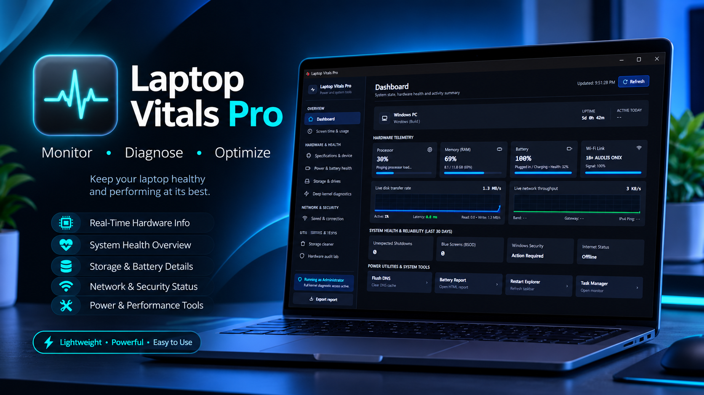

# ⚡ Laptop Vitals Pro

<p align="center">
  <b>A lightweight, zero-dependency, native Windows 11 hardware telemetry and system diagnostics utility.</b><br>
  Single portable binary (~343 KB) • Pitch-black OLED theme • 100% Offline & Private
</p>

<p align="center">
  
  
  
  
</p>

<p align="center">
  <a href="https://github.com/rasteq/laptopvitals/releases/latest/download/LaptopVitals-v1.0.0.exe">
    
  </a>
  <a href="https://rasteq.github.io/laptopvitals/">
    
  </a>
</p>

<p align="center">
  
</p>

---

## ✨ Highlights

- 🔋 **Battery Forensics:** Real hardware cycle counts, wear level %, design vs. full charge capacity (mWh), and 24h charge timeline.
- ⏱️ **Screen Time Analytics:** Accurate daily display time derived from Windows Event Logs (Sleep/Wake events 42, 107, 1, 41).
- 💾 **Storage SMART:** NVMe & SATA SSD operational health, real-time temperatures, and partition volume meters.
- ⚡ **Live Performance Graphs:** Real-time polyline telemetry for CPU, RAM, Disk I/O, and Network throughput.
- 🌐 **Wi-Fi & Speed Diagnostics:** 802.11ax/ac specs, DNS latency ping test, and secure offline viewer for saved Wi-Fi keys.
- 🛡️ **Security & Crash Logs:** Windows Defender readiness, Secure Boot, TPM 2.0, and 30-day BSOD BugCheck crash forensics.
- 🧹 **1-Click Storage Cleaner:** Safely purges temporary caches, thumbnail caches, and Windows Update cache.
- 📋 **Executive Diagnostic Report:** Generates a clean 1-page sanitized offline certificate on your Desktop.

---

## 🚀 Quick Start

1. Download **[`LaptopVitals-v1.0.0.exe`](https://github.com/rasteq/laptopvitals/releases/latest/download/LaptopVitals-v1.0.0.exe)** or get it directly from the [`release/`](release/) folder.
2. Double-click to launch — **zero installation or runtimes required**.
3. *(Optional)* Click **"Run as Administrator"** inside the app for low-level kernel, battery cycle inspection, and storage SMART sensors.

### 🔒 File Verification (SHA-256)

```powershell
Get-FileHash release\LaptopVitals-v1.0.0.exe
# SHA-256: 63B545B811CC743B3798DF54EC764339B9103B6DF963554B944113B6703046FD
```

> [!NOTE]
> **Windows SmartScreen:** Since this is an indie portable tool without an expensive commercial EV signing certificate, Windows SmartScreen may show an alert on first launch. Click **"More info"** ➔ **"Run anyway"**. The tool is 100% offline, gathers telemetry exclusively via standard local Windows APIs, and makes zero network requests.

---

## 👤 Author & License

- **Created by:** [Shahariar Ahammed](https://github.com/rasteq) ([@rasteq](https://github.com/rasteq))
- **Live Showcase:** [https://rasteq.github.io/laptopvitals/](https://rasteq.github.io/laptopvitals/)
- **Repository:** [https://github.com/rasteq/laptopvitals](https://github.com/rasteq/laptopvitals)
- **License:** [MIT License](LICENSE)
