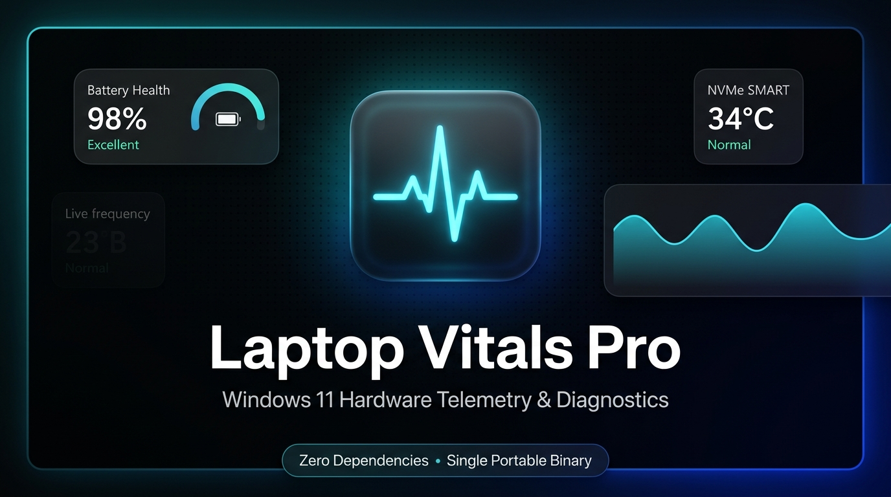

# ⚡ Laptop Vitals Pro

<p align="center">
  <b>A lightweight, zero-dependency, native Windows 11 Fluent hardware telemetry and system health utility.</b><br>
  <i>Single portable binary (~340 KB) • Pitch-black OLED theme • Deep battery and drive diagnostics</i>
</p>

<p align="center">
  
  
  
  
  
</p>

<p align="center">
  <a href="https://github.com/rasteq/LaptopVitals/releases/latest/download/LaptopVitals-v1.0.0.exe">
    
  </a>
  <a href="https://rasteq.github.io/LaptopVitals/">
    
  </a>
</p>

<p align="center">
  
</p>

---

## 📖 Overview

**Laptop Vitals Pro** is an ultra-fast, zero-bloat system health and hardware diagnostics tool tailored for Windows laptops and workstations. It packages deep hardware introspection, real-time performance graphs, event-log-derived screen time analytics, battery degradation forensics, NVMe SMART telemetry, Wi-Fi security audits, and junk cleaning into a single portable binary that runs instantly on vanilla Windows without requiring any runtimes or third-party installs.

---

## 📸 Application Interface

<p align="center">
  
</p>

---

## ✨ Key Features

### 🔋 Battery Health & Vitality
- **Degradation Analysis:** Factory design capacity vs. full charge capacity (mWh) and exact wear level percentage.
- **Cycle Count:** Real hardware battery cycle counts.
- **24-Hour & 7-Day History:** Detailed hourly charge/discharge timeline with AC/Battery usage duration.

### ⏱️ Screen Time & Usage Timeline
- **Windows Event Log Forensics:** Analyzes sleep/wake events (Events 42, 107, 1, 41) to calculate precise active display time.
- **Session Breakdowns:** Displays each continuous power and screen session start time, end time, and state.
- **Daily Activity Ratios:** 14-day activity bars with expandable session history.

### 💾 Storage & Drives Health
- **Physical Drives & SMART:** NVMe/SATA SSD health status, operational health, and real-time temperatures.
- **Volume Partitions:** Visual capacity meters for all logical volumes (C:, D:, etc.).

### ⚡ Real-Time Hardware Performance
- **Live Graphs:** Real-time polyline telemetry for CPU, RAM, Disk I/O, and Network throughput.
- **Resource Consumers:** Top memory-intensive applications and Windows startup items.

### 🌐 Network & Speed Diagnostics
- **Connection Specs:** Wi-Fi radio protocol (802.11ax/ac/n), band, channel, and link speeds (Rx/Tx).
- **Latency & Ping:** Real-time round-trip latency to DNS root servers with packet loss verification.
- **Saved Wi-Fi Passwords:** Secure offline viewer for all saved Wi-Fi profiles and network security keys.

### 🛡️ Security & Kernel Diagnostics
- **Security Enclave:** Windows Defender real-time protection, Secure Boot, TPM 2.0, and UAC readiness.
- **Kernel Crash Forensics:** 30-day dirty shutdown and Blue Screen (BSOD) minidump incident logs.

### 🧹 Storage Cleaner
- **Safe Junk Removal:** Scans and purges temporary files, thumbnail caches, and Windows Update cache to recover disk space in one click.

### 📋 Executive Diagnostic Report Export
- **Clean 1-Page Offline Report:** Generates an executive hardware verification certificate saved directly to your Desktop.
- **Privacy Hardened:** Automatically sanitizes serial numbers, MAC addresses, and passwords so reports are safe to share with technicians or buyers.

---

## 🚀 Quick Start (Zero Installation)

1. Download **`LaptopVitals-v1.0.0.exe`** directly from this repository or the Releases page.
2. Double-click to launch!
3. *(Optional)* Click **"Run as Administrator"** inside the app for low-level kernel, battery cycle inspection, and storage SMART sensors.

### 🔒 File Verification & Integrity
Verify your downloaded binary using Windows PowerShell (`Get-FileHash LaptopVitals-v1.0.0.exe`):

| File | Architecture | Size | SHA-256 Checksum |
| :--- | :--- | :--- | :--- |
| **`LaptopVitals-v1.0.0.exe`** | Windows x64 | ~343 KB | `63B545B811CC743B3798DF54EC764339B9103B6DF963554B944113B6703046FD` |

> [!NOTE]
> **Windows SmartScreen Notice:** Since this is a newly published indie portable tool without an expensive commercial EV signing certificate, Windows SmartScreen may show an alert on first launch. Click **"More info"** ➔ **"Run anyway"**. The application is 100% offline, gathers telemetry exclusively via standard local Windows APIs, and makes zero network requests.

---

## 📂 Repository Contents

```text
├── assets/
│   ├── preview_01.png        # High-resolution hero banner
│   └── preview_02.png        # Native Windows 11 interface screenshot
├── LaptopVitals-v1.0.0.exe   # Standalone portable binary (~343 KB)
├── index.html                # Live GitHub Pages web showcase & download portal
├── README.md                 # Documentation, features & verification
├── LICENSE                   # MIT License
└── .gitignore                # Git ignore rules
```

---

## 🔒 Privacy & Security

- **100% Offline:** All diagnostics and telemetry are gathered locally using standard Windows APIs (`WMI`, `Event Log`, `PowerCfg`, `Netsh`).
- **Zero Telemetry Collection:** No analytics, trackers, or remote servers are pinged.
- **Clean Reports:** Exported diagnostic reports intentionally exclude private network keys, IP addresses, and MAC addresses.

---

## 👤 Author & Support

- **Created by:** [Shahariar Ahammed](https://github.com/rasteq) ([@rasteq](https://github.com/rasteq))
- **Repository:** [https://github.com/rasteq/LaptopVitals](https://github.com/rasteq/LaptopVitals)
- **Live Showcase:** [https://rasteq.github.io/LaptopVitals/](https://rasteq.github.io/LaptopVitals/)
- **Issues & Suggestions:** Please open an issue on the [GitHub Issues](https://github.com/rasteq/LaptopVitals/issues) page.
- ⭐ If you find this utility useful, please star the repository!

---

## 📄 License

This project is licensed under the [MIT License](LICENSE).
